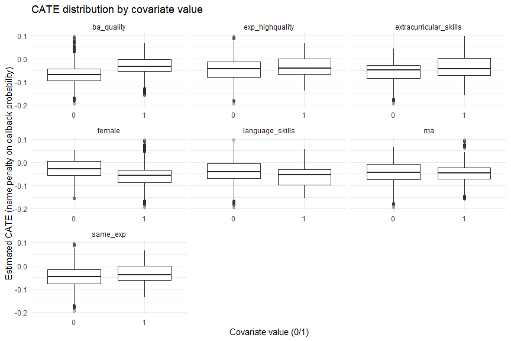
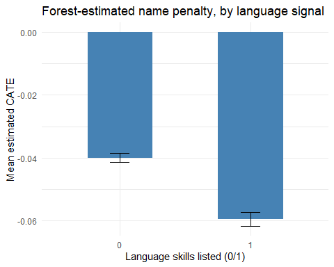

Causal Forest: Presenting CATEs Across Covariate Values (Section 5.3
Style)
================
DSE4101 Digital Economy Group 1
2026-09-19

- [Setup](#setup)
- [Sample construction](#sample-construction)
- [Fitting the causal forest](#fitting-the-causal-forest)
- [Step 1: is there real heterogeneity here at
  all?](#step-1-is-there-real-heterogeneity-here-at-all)
- [Step 2: extract per-observation CATE
  estimates](#step-2-extract-per-observation-cate-estimates)
- [Step 3: Section 5.3 style – CATEs across each
  covariate](#step-3-section-53-style--cates-across-each-covariate)
- [Step 4: statistical backup – Best Linear
  Projection](#step-4-statistical-backup--best-linear-projection)
- [Step 5: spotlight comparison for
  language_skills](#step-5-spotlight-comparison-for-language_skills)

This script fits the restricted-treatment causal forest (Type 0 vs. Type
1, Chinese/Indian/Pakistani/Canada – the same base treatment as
`interaction1_language_signal.Rmd`), then presents its heterogeneity the
way Rehill’s (2025) review describes as the most common approach in the
literature (Section 5.3): plotting individual CATE estimates against
each covariate. Since our covariates are binary, this takes the form of
boxplots/group comparisons rather than a smoothed continuous curve.

# Setup

``` r
required_packages <- c("haven", "dplyr", "grf", "ggplot2", "tidyr")
missing_packages  <- setdiff(required_packages, rownames(installed.packages()))
if (length(missing_packages) > 0) {
  install.packages(missing_packages, repos = "https://cloud.r-project.org")
}
library(haven)
library(dplyr)
library(grf)
library(ggplot2)
library(tidyr)

data_path <- file.path("data", "oreopoulos-resume-study-replication-data-file.dta")
if (!file.exists(data_path)) {
  stop("Data file not found. Expected it at: ", normalizePath(data_path, mustWork = FALSE))
}
df <- read_dta(data_path)

# haven::read_dta() preserves Stata's variable/value labels as an extra
# "haven_labelled" class on top of each numeric column. lm_robust() (used
# elsewhere in this project) silently strips this when building its model
# formula, but grf::causal_forest() does not -- its internal validation
# calls is.vector() on Y and W, which returns FALSE for anything carrying
# extra attributes, including haven_labelled. zap_labels() removes that
# metadata so every column becomes a plain numeric vector.
df <- haven::zap_labels(df)
```

# Sample construction

Identical restriction to the interaction models: Type 0 vs. Type 1,
restricted to Canada/Chinese/Indian/Pakistani names. `accreditation`,
`legal`, and `reference` are dropped entirely from the covariate set –
they are structurally constant (always 0) in this subsample, since those
characteristics only exist for resumes claiming foreign credentials, and
a zero-variance covariate cannot be split on.

``` r
df_cf <- df %>%
  filter(
    type %in% c(0, 1),
    name_ethnicity %in% c("Canada", "Chinese", "Indian", "Pakistani")
  ) %>%
  mutate(
    W  = as.numeric(type == 1),
    Y  = callback,
    female                 = ifelse(is.na(female), 0, female),
    ba_quality              = ifelse(is.na(ba_quality), 0, ba_quality),
    extracurricular_skills  = ifelse(is.na(extracurricular_skills), 0, extracurricular_skills),
    language_skills          = ifelse(is.na(language_skills), 0, language_skills),
    ma                      = ifelse(is.na(ma), 0, ma),
    same_exp                = ifelse(is.na(same_exp), 0, same_exp),
    exp_highquality         = ifelse(is.na(exp_highquality), 0, exp_highquality),
    fall_data               = as.numeric(as.factor(fall_data))
  )

covariate_names <- c("female", "ba_quality", "extracurricular_skills",
                      "language_skills", "ma", "same_exp", "exp_highquality")

# fall_data is included as a covariate to help the forest's internal Y.hat/W.hat
# regressions, but is not one of the substantive covariates we plot CATEs against.
#
# X, Y, and W are explicitly coerced here rather than relying on zap_labels()
# alone: haven columns can carry a *separate* singular "label" attribute (the
# Stata variable description) in addition to the "labels" (value labels)
# attribute that zap_labels() removes. is.vector() -- which grf's internal
# validate_observations() uses -- returns FALSE if ANY attribute remains,
# regardless of which one. as.numeric() and data.matrix() strip everything
# unconditionally, guaranteeing plain vectors/matrix no matter what metadata
# haven left behind.
X <- data.matrix(df_cf[, c(covariate_names, "fall_data")])
Y <- as.numeric(df_cf$Y)
W <- as.numeric(df_cf$W)
clusters <- as.numeric(as.factor(df_cf$firmid))

# --- Diagnostics: run this chunk and share the printed output ---
cat("class(Y):", class(Y), "\n")
```

    ## class(Y): numeric

``` r
cat("is.vector(Y):", is.vector(Y), "\n")
```

    ## is.vector(Y): TRUE

``` r
cat("length(Y):", length(Y), "\n")
```

    ## length(Y): 5657

``` r
cat("attributes(Y):\n"); print(attributes(Y))
```

    ## attributes(Y):

    ## NULL

``` r
cat("\nclass(W):", class(W), "\n")
```

    ## 
    ## class(W): numeric

``` r
cat("is.vector(W):", is.vector(W), "\n")
```

    ## is.vector(W): TRUE

``` r
cat("length(W):", length(W), "\n")
```

    ## length(W): 5657

``` r
cat("attributes(W):\n"); print(attributes(W))
```

    ## attributes(W):

    ## NULL

``` r
cat("\nclass(X):", class(X), "\n")
```

    ## 
    ## class(X): matrix array

``` r
cat("dim(X):", dim(X), "\n")
```

    ## dim(X): 5657 8

``` r
cat("nrow(df_cf):", nrow(df_cf), "\n")
```

    ## nrow(df_cf): 5657

``` r
cat("Analysis sample size:", nrow(df_cf), "\n")
```

    ## Analysis sample size: 5657

``` r
cat("Treatment (W) distribution:\n")
```

    ## Treatment (W) distribution:

``` r
print(table(W))
```

    ## W
    ##    0    1 
    ## 3026 2631

# Fitting the causal forest

`clusters` is passed explicitly – the same reasoning as clustering the
standard errors in the interaction models applies here: Type 0 and Type
1 resumes were sent to the same employer within the same short window,
so resumes are not independent observations, and the forest needs to
know that when estimating variance.

``` r
cf <- causal_forest(
  X = X,
  Y = Y,
  W = W,
  clusters = clusters,
  honesty = TRUE
)
```

# Step 1: is there real heterogeneity here at all?

Before looking at any covariate-specific plot, run the calibration test.
The `differential.forest.prediction` coefficient is the one that matters
– if it is not distinguishable from zero, the honest conclusion is that
the forest did not find heterogeneity beyond the average effect, and the
plots below should be read as exploratory rather than confirmatory.

``` r
test_calibration(cf)
```

    ## 
    ## Best linear fit using forest predictions (on held-out data)
    ## as well as the mean forest prediction as regressors, along
    ## with one-sided heteroskedasticity-robust (HC3) SEs:
    ## 
    ##                                Estimate Std. Error t value    Pr(>t)    
    ## mean.forest.prediction         0.995903   0.156990  6.3437 1.208e-10 ***
    ## differential.forest.prediction 0.090766   0.188439  0.4817     0.315    
    ## ---
    ## Signif. codes:  0 '***' 0.001 '**' 0.01 '*' 0.05 '.' 0.1 ' ' 1

# Step 2: extract per-observation CATE estimates

`predict()` with no `newdata` returns out-of-bag predictions by default
– each person’s estimate comes from trees that did not include them when
deciding splits, avoiding the same in-sample overfitting problem that
motivated honesty splitting in the first place.

``` r
preds <- predict(cf, estimate.variance = TRUE)
tau_hat <- preds$predictions
tau_se  <- sqrt(preds$variance.estimates)

df_cf$tau_hat <- tau_hat
df_cf$tau_se  <- tau_se
```

# Step 3: Section 5.3 style – CATEs across each covariate

Since every covariate here is binary, there is no continuum to trace a
smoothed line across (unlike Figure 5 in Rehill (2025), built on
continuous simulated covariates). The direct equivalent is a boxplot
comparing the two groups for each covariate, faceted together.

``` r
df_long <- df_cf %>%
  select(tau_hat, all_of(covariate_names)) %>%
  pivot_longer(cols = all_of(covariate_names), names_to = "covariate", values_to = "value")

ggplot(df_long, aes(x = factor(value), y = tau_hat)) +
  geom_boxplot(outlier.alpha = 0.3) +
  facet_wrap(~ covariate, scales = "free_x") +
  labs(
    x = "Covariate value (0/1)",
    y = "Estimated CATE (name penalty on callback probability)",
    title = "CATE distribution by covariate value"
  ) +
  theme_minimal()
```

<!-- -->

# Step 4: statistical backup – Best Linear Projection

A boxplot difference is suggestive, not proof. For a binary covariate,
the BLP coefficient is mathematically the same quantity as the
difference between the two boxes’ means, but with a properly resampled
standard error and p-value attached – this is the number to actually
cite, not the picture.

``` r
blp_results <- best_linear_projection(cf, X[, covariate_names])
print(blp_results)
```

    ## 
    ## Best linear projection of the conditional average treatment effect.
    ## Confidence intervals are cluster- and heteroskedasticity-robust (HC3):
    ## 
    ##                           Estimate  Std. Error t value Pr(>|t|)   
    ## (Intercept)            -0.07229488  0.02200561 -3.2853 0.001025 **
    ## female                 -0.03693467  0.01820305 -2.0290 0.042501 * 
    ## ba_quality              0.04316127  0.01834997  2.3521 0.018701 * 
    ## extracurricular_skills  0.02532413  0.01936108  1.3080 0.190929   
    ## language_skills        -0.01059127  0.02180557 -0.4857 0.627189   
    ## ma                     -0.00087955  0.02272763 -0.0387 0.969131   
    ## same_exp                0.02373916  0.02458365  0.9656 0.334262   
    ## exp_highquality         0.00422518  0.02485259  0.1700 0.865009   
    ## ---
    ## Signif. codes:  0 '***' 0.001 '**' 0.01 '*' 0.05 '.' 0.1 ' ' 1

# Step 5: spotlight comparison for language_skills

Since this connects directly back to Interaction Model 1
(`interaction1_language_signal.Rmd`), it’s worth a dedicated, cleaner
comparison: group means with confidence intervals rather than a full
boxplot, which reads more like the coefficient-style output already used
elsewhere in this project.

``` r
language_summary <- df_cf %>%
  group_by(language_skills) %>%
  summarise(
    mean_tau = mean(tau_hat),
    se_tau   = sd(tau_hat) / sqrt(n()),
    n        = n()
  )

ggplot(language_summary, aes(x = factor(language_skills), y = mean_tau)) +
  geom_col(fill = "steelblue", width = 0.5) +
  geom_errorbar(aes(ymin = mean_tau - 1.96 * se_tau, ymax = mean_tau + 1.96 * se_tau),
                width = 0.15) +
  labs(
    x = "Language skills listed (0/1)",
    y = "Mean estimated CATE",
    title = "Forest-estimated name penalty, by language signal"
  ) +
  theme_minimal()
```

<!-- -->

**Reading this alongside Interaction Model 1:** the BLP coefficient on
`language_skills` from Step 4 is the forest’s version of the
`W:language_skills` coefficient from the linear interaction model. If
the two roughly agree in sign, size, and significance, that’s evidence
the forest confirms the earlier null result. If they diverge, that’s
evidence of heterogeneity the single pre-specified linear interaction
missed – either way, report both numbers side by side rather than the
plot alone.
